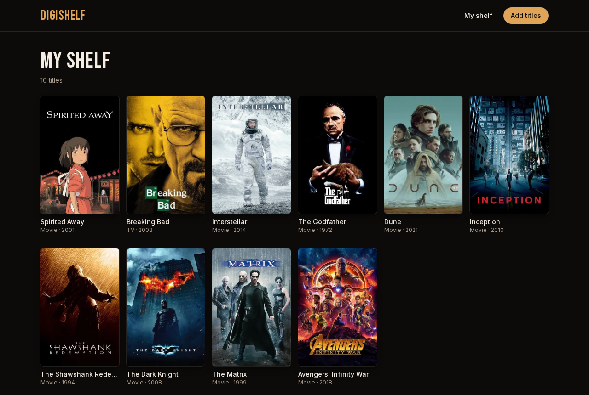

# Digishelf

A digital shelf for the movies and TV shows you love, so you can come back to them later.

Search [TMDB](https://www.themoviedb.org), put what you find on your shelf, and browse it as a wall of posters.

 The [MVP issue](https://github.com/Rohin-Chopra/digishelf/issues/4) tracks the first release, and the [`idea` issues](https://github.com/Rohin-Chopra/digishelf/issues?q=is%3Aissue+is%3Aopen+label%3Aidea) list what comes next.

## Tech stack

- [Next.js 16](https://nextjs.org) (App Router) with React 19 and TypeScript
- [Tailwind CSS 4](https://tailwindcss.com)
- [TMDB API](https://developer.themoviedb.org/docs) for movie and TV data
- pnpm workspaces and [Turborepo](https://turbo.build)
- ESLint, Prettier, husky, lint-staged and commitlint (Conventional Commits)

## How it works

- `/search` searches movies and TV shows through `GET /api/search?q=`, a route handler that calls TMDB's `/search/multi` on the server so `TMDB_API_KEY` never reaches the browser.
- `/` shows your shelf. For now it lives in `localStorage` (`digishelf:shelf:v1`), so no account is needed; accounts and a database come later.
- Posters load straight from TMDB's image CDN through a custom `next/image` loader that picks the closest TMDB size.

## Repository layout

```
apps/web   Next.js app
```

## Running locally

Requirements: Node 26 (see `.nvmrc`) and pnpm 10.

```bash
pnpm install
cp .env.example apps/web/.env.local   # then fill in TMDB_API_KEY
pnpm dev                               # http://localhost:3000
```

Get a free TMDB key at <https://www.themoviedb.org/settings/api>. `TMDB_API_KEY` takes either the v4 "API Read Access Token" or the v3 "API Key".

### Scripts

| Command          | What it does                    |
| ---------------- | ------------------------------- |
| `pnpm dev`       | Start the dev server            |
| `pnpm build`     | Production build                |
| `pnpm lint`      | ESLint                          |
| `pnpm typecheck` | TypeScript                      |
| `pnpm test`      | Unit tests                      |
| `pnpm format`    | Format everything with Prettier |

## Attribution


This product uses the TMDB API but is not endorsed or certified by TMDB.

## Deployment

Pushes to `main` deploy to [digishelf.rohinchopra.com](https://digishelf.rohinchopra.com) via [`.github/workflows/deploy.yml`](.github/workflows/deploy.yml): CI, then `pnpm --filter web build:aws` ([OpenNext](https://opennext.js.org/aws)), then `pulumi up` on the `production` stack of [`infra/app`](infra/app), then a smoke test against the live site.

- `infra/app`: S3 (static assets and prerendered pages), a Node 26 Lambda behind a function URL, CloudFront, ACM and Route 53, in `ap-southeast-4`.
- `infra/github`: the OIDC role GitHub Actions assumes. Only jobs in the `production` environment can use it.
- Pulumi state is in S3 (`digishelf-pulumi-state-<account>`) and stack secrets are encrypted with the `alias/digishelf-pulumi` KMS key.

One-off setup, with admin AWS credentials and the Pulumi CLI:

```sh
pnpm install && pnpm --filter web build:aws
TMDB_API_KEY=... infra/bootstrap.sh
```

Then, in GitHub, create a `production` environment and set the repository variable `AWS_ROLE_ARN` to the role the script prints.
